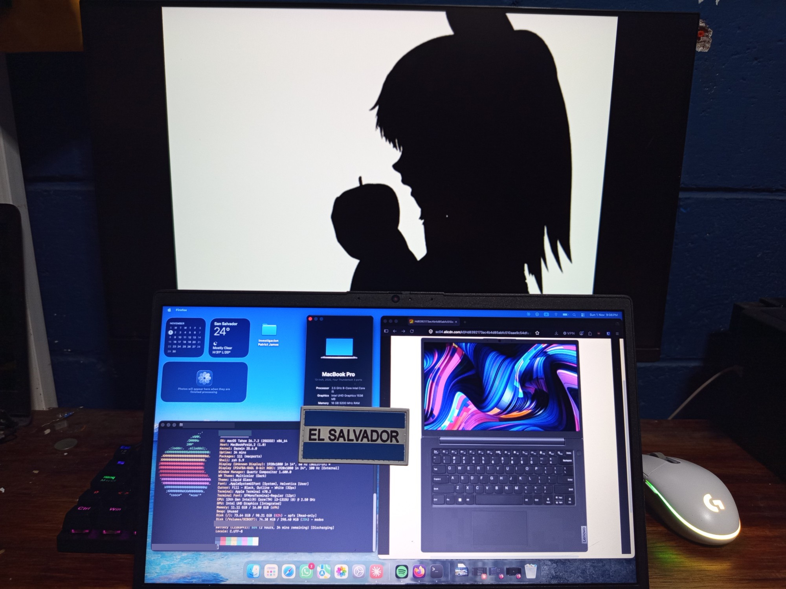
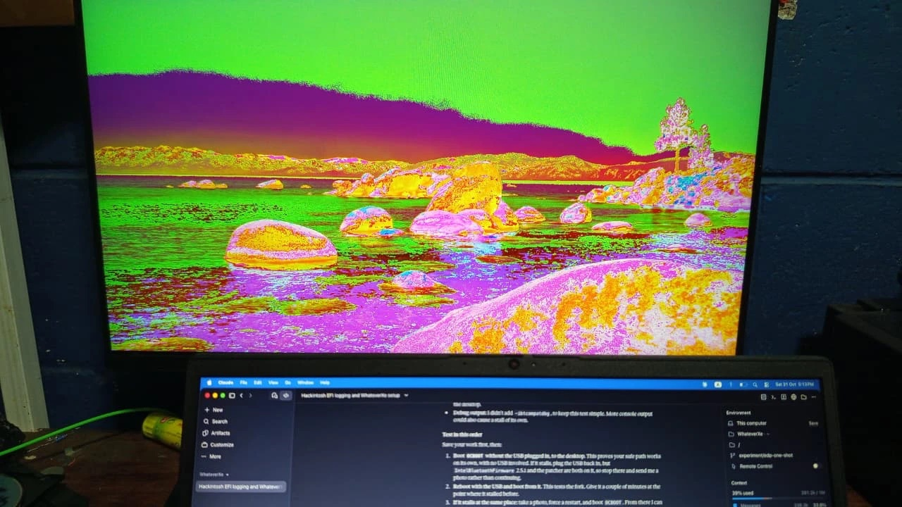
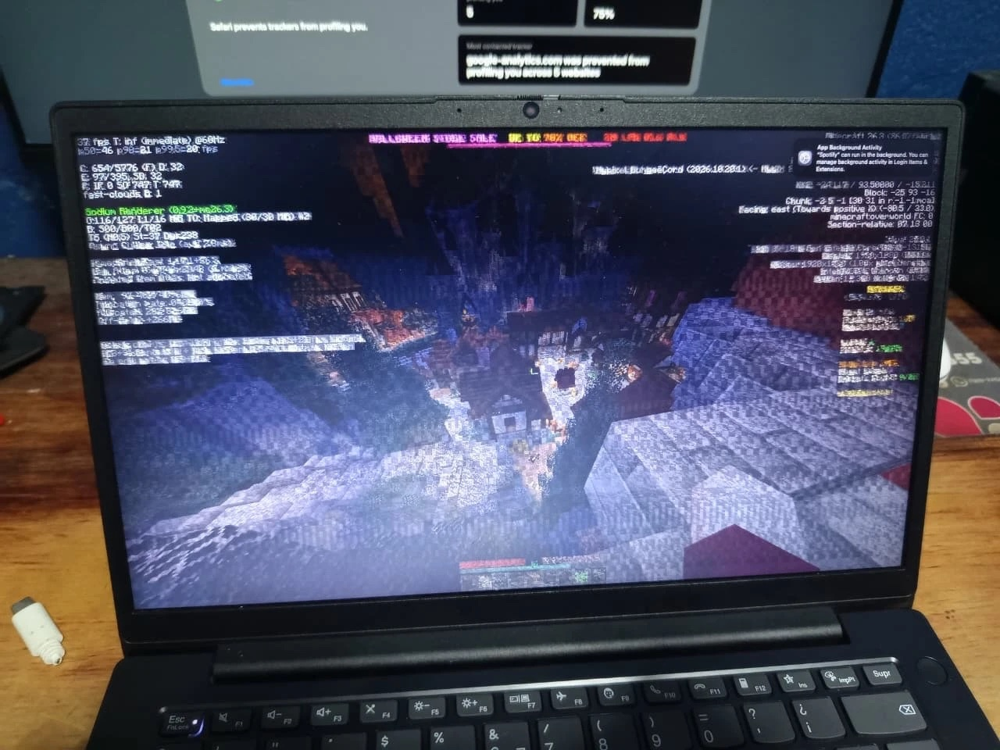
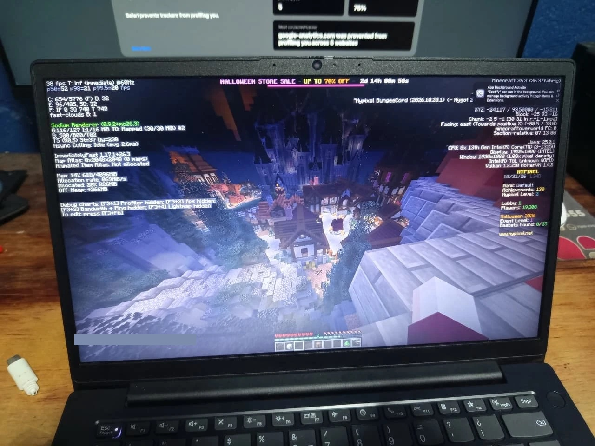

# Hackintosh: Lenovo ZhaoYang X3-14 IRL

[English](README.md) | **Español**

macOS 26.7.2 (25G332) en la Lenovo ZhaoYang X3-14 IRL 83GX. Este repositorio reúne lo que es específico de esta laptop.

**Esta es una configuración experimental y solo de depuración.** Puede congelarse, dar kernel panic o mostrar gráficos incorrectos. Úsala bajo tu propio riesgo, y ten a mano un instalador USB funcional y copias de seguridad.

## Galería

<table>
<tr>
<td width="50%"> Primera salida HDMI, con colores mal representados.</td>
<td width="50%"> Hangar de War Thunder. Abre la imagen para ver el video.</td>
</tr>
<tr>
<td> Minecraft con Vulkan y MoltenVK, con bugs.</td>
<td> La misma vista con imagen correcta.</td>
</tr>
</table>

## Detalles

### Sistema

| Elemento | Valor |
| --- | --- |
| Laptop | Lenovo ZhaoYang X3-14 IRL |
| Modelo | 83GX |
| Placa | LNVNB161216 |
| BIOS | Insyde, PMCN38WW, 2026-04-01 |
| EC | 1.27 |
| SMBIOS | MacBookPro16,2 (`Mac-5F9802EFE386AA28`) |
| macOS | Tahoe 26.7.2 (25G332), Darwin 25.6.0 |
| Recovery | 26.6.2 (25G83) |
| OpenCore | 1.0.8, `DBG-108-2026-09-27` |
| [WhateverXe](https://github.com/crissuper20/WhateverXe) | 0.6.1, build ONCE20, etiqueta [`once20-checkpoint`](https://github.com/crissuper20/WhateverXe/tree/once20-checkpoint) |
| AppleIntelTGLCompat | 0.6.1 |
| WhateverXe-Graphics | 0.3.2 |

### Hardware

| Componente | Detalles |
| --- | --- |
| CPU | Intel Core i3-1315U, 2P+4E, firma `B06A3`, microcódigo `0x6134`. macOS la ve como `A0655` mediante `Cpuid1Data`. |
| GPU | Intel UHD (Raptor Lake-U), `8086:A7A9` |
| RAM | 16 GB DDR5-5200: Samsung 8 GB `M425R1GB4PB0-CWMOL`, Micron 8 GB `MTC4C10163S1SC56BD1` |
| Almacenamiento | UMIS `RPJTJ256MMQ1MDY`, NVMe de 256 GB, firmware `1.0L06B0`, PCIe 16 GT/s x4 |
| Pantalla | `LEN9021`, 1920x1080 a 60 Hz, 8 bpc, eDP |
| Audio | Conexant SN6140, `14F1:1F87`, revisión `0x100100`, layout 21 |
| Ethernet | Realtek RTL8168H/8111H |
| Wi-Fi | Intel CNVi, `8086:51F1` |
| Bluetooth | Intel, `8087:0026` |
| Cámara | `04F2:B7EC`, UVC nativo |
| Teclado | PS/2 |
| Trackpad | ELAN06FA en I2C1, modo polling |
| Batería | BYD `L22B3PF2`, 4155 mAh en la última lectura |

### Kexts

En orden de carga.

| Kext | Versión | Función |
| --- | --- | --- |
| Lilu | 1.7.2 | Base de parches |
| AppleALC | 1.9.9, build SN6140 personalizada | Audio layout 21 |
| SimpleHDA | 1.0.0 | HD Audio |
| VirtualSMC | 1.3.8 | Emulación de SMC |
| SMCProcessor | 1.3.8 | Sensores de CPU |
| SMCBatteryManager | 1.3.8 | Batería |
| ECEnabler | 1.0.6 | Campos EC de la batería |
| AMFIPass | 1.4.1 | Evita AMFI |
| [WhateverXe](https://github.com/crissuper20/WhateverXe) | 0.6.1, ONCE20 | Gráficos |
| RestrictEvents | 1.1.6 | Avisos de memoria y PCI |
| CpuTopologyRebuild | 2.0.2 | Topología de CPU híbrida |
| CpuTscSync | 1.1.2 | Sincronización de TSC |
| NVMeFix | 1.1.3 | Energía de NVMe |
| RealtekRTL8111 | 3.0.4 | Ethernet |
| itlwm | 2.3.0 | Wi-Fi, se usa con HeliPort |
| BlueToolFixup | 2.7.2 | Bluetooth en Tahoe |
| IBTFw251 | 2.5.1 | Firmware de Bluetooth |
| IBTPatch251 | 2.5.1 | Parches de Bluetooth |
| USBToolBox | 1.2.0 | USB |
| UTBDefault | 1.0 | USB, mapa por defecto |
| VoodooPS2Controller | 2.3.7 | Teclado PS/2 |
| VoodooPS2Keyboard | 2.3.7 | Teclado PS/2 |
| VoodooI2C | 2.9.1 | Trackpad I2C |
| VoodooI2CServices | 1.0 | Plugin de VoodooI2C |
| VoodooGPIO | 1.1 | Plugin de VoodooI2C |
| VoodooInput | 1.1.6 | Plugin de VoodooI2C |
| VoodooI2CHID | 1.0 | Trackpad HID |

### Configuración de OpenCore

| Ajuste | Valor |
| --- | --- |
| Argumentos de arranque | `-v keepsyms=1 debug=0x100 msgbuf=1048576 -alcdbg -shdadbg liludump=120 -ibtcompatbeta -cputsbeta -cputsdbg -allow3d -disablegfxfirmware -igfxdvmt -wexdbg -wex-display13-trace -wex-display-trace -vi2c-force-polling alcid=21 -wexhangcap` |
| `csr-active-config` | `03080000` |
| Seguridad | SecureBootModel `Disabled`, Vault `Optional`, ScanPolicy `0`, DmgLoading `Signed` |
| `Cpuid1Data` y máscara | `55060A00000080000000000000000000`, `FFFFFFFF0000FF000000000000000000` |
| Drivers UEFI | OpenRuntime, ResetNvramEntry, HfsPlus (no incluido en las releases), AudioDxe desactivado |
| SSDT | PLUG-ALT, EC-USBX-LAPTOP, RTCAWAC, XOSI, PNLF |
| Parche ACPI | `_OSI` a `XOSI`, solo DSDT |
| Propiedades de iGPU | `framebuffer-patch-enable` `01000000`, `framebuffer-stolenmem` `0000C003` |
| Propiedades de I2C1 | `device-id` `E9020000` en `Pci(0x15,0x1)` |
| Quirks de Booter | AvoidRuntimeDefrag, DevirtualiseMmio, EnableSafeModeSlide, FixupAppleEfiImages, ProtectUefiServices, ProvideCustomSlide, RebuildAppleMemoryMap, SetupVirtualMap, SyncRuntimePermissions |
| Quirks de Kernel | AppleXcpmCfgLock, DisableIoMapper, DisableLinkeditJettison, PanicNoKextDump, PowerTimeoutKernelPanic, ProvideCurrentCpuInfo |
| Quirks de UEFI | EnableVectorAcceleration, ReleaseUsbOwnership, RequestBootVarRouting; override de FirmwareVolume |

### Argumentos de arranque

| Argumento | Función |
| --- | --- |
| `-v keepsyms=1 debug=0x100 msgbuf=1048576` | Arranque detallado, símbolos en los panics, sin reinicio tras un panic, log del kernel más grande |
| `alcid=21` | Layout de audio SN6140 |
| `-alcdbg -shdadbg liludump=120` | Logs de depuración de AppleALC, SimpleHDA y Lilu |
| `-ibtcompatbeta` | Permite Intel Bluetooth en esta versión de macOS |
| `-cputsbeta -cputsdbg` | CpuTscSync en esta versión de macOS, con logs |
| `-allow3d -disablegfxfirmware -igfxdvmt` | Opciones gráficas de WhateverXe usadas en esta máquina |
| `-wexdbg -wex-display13-trace -wex-display-trace -wexhangcap` | Logs de depuración de WhateverXe y captura de bloqueos de GPU |
| `-vi2c-force-polling` | Modo polling de VoodooI2C para el trackpad |

El arranque detallado con muchos logs puede detenerse en la consola, así que una pausa larga no siempre es un bloqueo.

### ACPI

Generados a partir de las tablas de esta misma máquina.

| SSDT | Motivo |
| --- | --- |
| `SSDT-PLUG-ALT` | Asigna los 64 dispositivos `ACPI0007` PRxx a objetos Processor, con plugin-type en el primero |
| `SSDT-EC-USBX-LAPTOP` | El EC real es `LPCB.EC0`; agrega un `EC` falso y energía USB |
| `SSDT-RTCAWAC` | Pone `STAS = 1`: RTC heredado activo y AWAC apagado |
| `SSDT-XOSI` | Se usa con el parche `_OSI`, porque `TPD0._CRS` no devuelve descriptor I2C cuando `OSYS < 0x07DC` |
| `SSDT-PNLF` | Brillo de la pantalla interna |

## Estado

Funciona en esta máquina: escritorio en la pantalla interna, aplicaciones Metal y OpenGL, y Bluetooth.

Problemas conocidos:

- Los bloqueos de la GPU pueden congelar la máquina.
- La decodificación H.264 por hardware se queda detenida.
- HDMI muestra colores incorrectos si el monitor no tiene un override de pantalla en RGB.
- En sesiones largas aparecen fugas de memoria en Metal y WindowServer.

## Estructura

- `config/`: configuraciones de OpenCore de la etapa 1, la etapa 2 y la actual, todas con seriales de ejemplo.
- `acpi/`: SSDT compilados en uso.
- `audio/`: perfil de audio SN6140 personalizado y script de compilación.
- `gallery/`: fotos y video de esta galería.
- `tools/make-efi.py`: genera el zip de la release.
- `tools/collect-linux.sh`: captura opcional de hardware desde un USB live de Linux.

## Instalación

Las releases incluyen una carpeta OpenCore de depuración lista para usar. Todas las releases actuales son de depuración. Los drivers de Apple y la imagen de recovery no están incluidos aquí.

Genera tu propio serial, MLB, UUID y ROM antes de usar cualquier configuración, por ejemplo con GenSMBIOS. Los valores de ejemplo no deben usarse tal cual. `HfsPlus.efi` no está incluido porque es software de Apple, así que agrega tu propio driver si necesitas HFS+ en OpenCore.

| Etapa | Configuración | Gráficos |
| --- | --- | --- |
| 1 | `config-stage1.sample.plist` | Framebuffer del firmware a 1920x1080. Se usa para instalar macOS. |
| 2 | `config-stage2.sample.plist` | WhateverXe y AMFIPass activos. Cambia después de actualizar a 26.7.2. |
| Actual | `config.sample.plist` | Etapa 2 más audio, Bluetooth funcional y los argumentos de uso diario. |

Copia `EFI/` y `com.apple.recovery.boot/` a un USB FAT32 e instala macOS en un SSD externo con Ethernet conectado, porque el Wi-Fi necesita HeliPort. Actualiza a 25G332 en la etapa 1, ya que las comprobaciones del driver son exactas, luego instala WhateverXe-Graphics 0.3.2 desde [b00t0x/WhateverXe-Graphics](https://github.com/b00t0x/WhateverXe-Graphics) y pasa a la etapa 2. Si la etapa 2 da pantalla negra, vuelve a la etapa 1 o agrega `-wex-noaccel`. Mantén la suspensión apagada con `sudo pmset -a hibernatemode 0 standby 0 sleep 0`.

El recovery es 26.6.2 (25G83), el más reciente que Apple ofrecía en octubre de 2026. Descárgalo con `macrecovery.py`:

| Archivo | SHA-256 |
| --- | --- |
| `BaseSystem.dmg` | `edddd0d5869caaa12e29e6996a04f11590280580976a119dbd42c24fa62fe18e` |
| `BaseSystem.chunklist` | `06f7c498f856341f467ba1faedf2717fb2c172ae0aff4658a1467cbf46b711f9` |

BIOS (F2): Secure Boot apagado. VT-d apagado y DVMT a 96 MB si esas opciones existen, porque Lenovo oculta la mayoría. El menú de arranque es F12.

| El arranque se detiene en | Prueba |
| --- | --- |
| Justo después de `EXITBS:START` | Cambia `DevirtualiseMmio` y revisa que VT-d esté apagado |
| `EB.MM.AKM` o sin slide | Desactiva el inicio rápido de Windows y mantén `ProvideCustomSlide` |
| Configuración PCI | Quita `-igfxdvmt` o vuelve a la etapa 1 |
| Trackpad sin respuesta | Usa un mouse USB y revisa VoodooI2C en `ioreg` |

El kext gráfico es la build ONCE20, etiqueta `once20-checkpoint` de [mi fork](https://github.com/crissuper20/WhateverXe) de [b00t0x/WhateverXe](https://github.com/b00t0x/WhateverXe).

Gracias a: [X1 Carbon G11 en Tahoe](https://github.com/dssoftx/Hackintosh-X1Carbon-G11-IrisXe-Tahoe), por la base de Raptor Lake y la solución de `EXITBS`; [samranahmad09/WhateverXe-RaptorLakeP](https://github.com/samranahmad09/WhateverXe-RaptorLakeP), el fork de Raptor Lake-P; [acidanthera/AppleALC](https://github.com/acidanthera/AppleALC), la base del audio.
