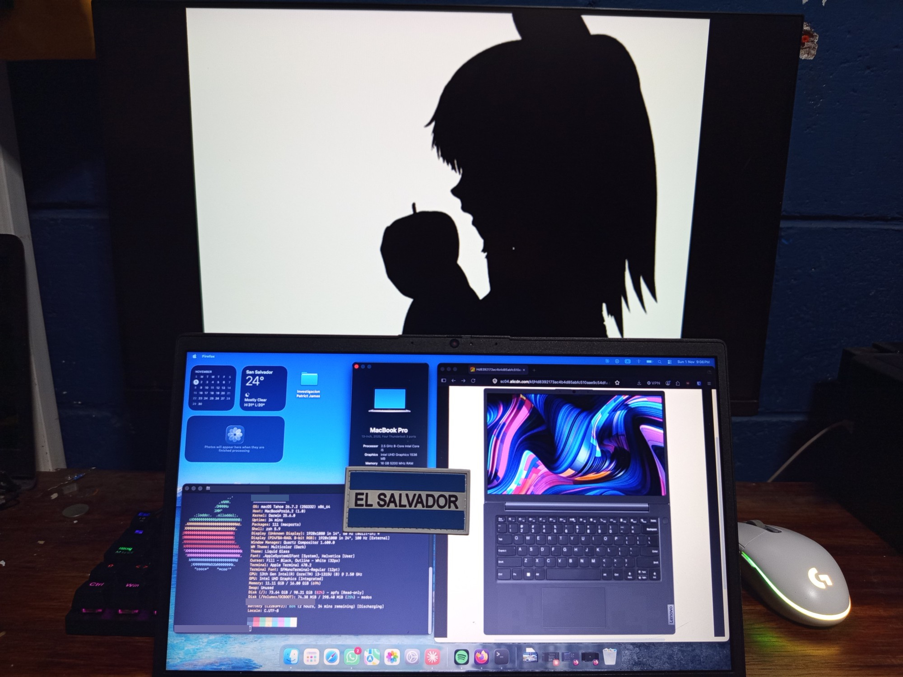
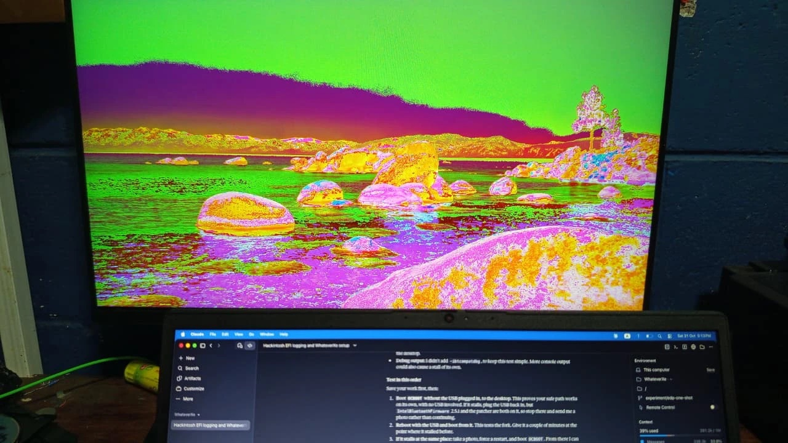
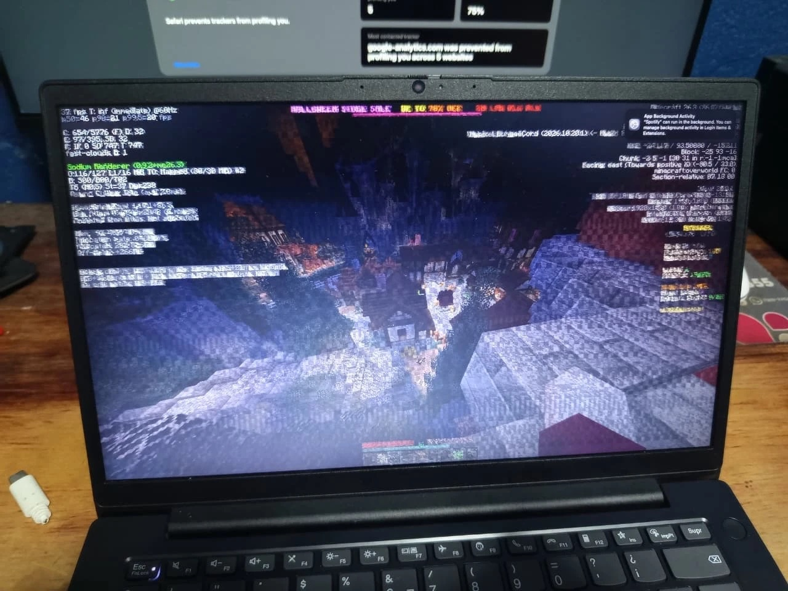
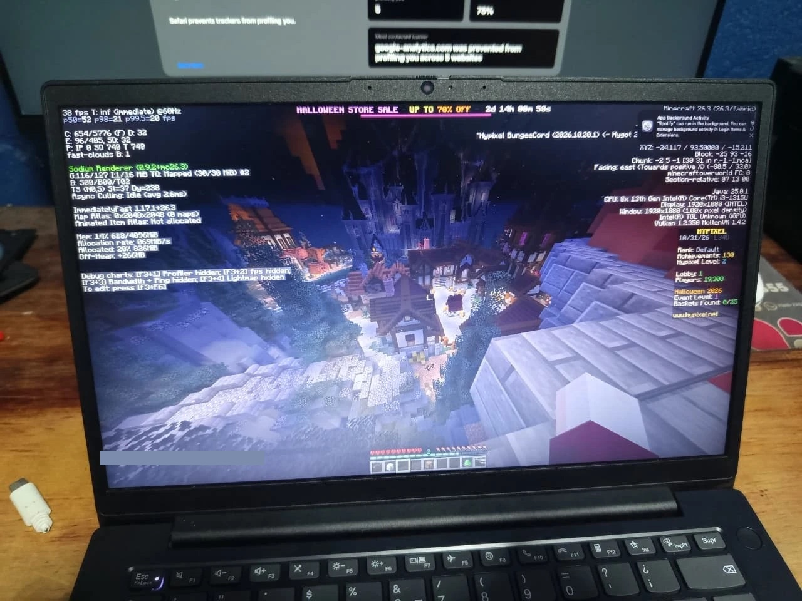

# Hackintosh: Lenovo ZhaoYang X3-14 IRL

**English** | [Español](LEEME.md)

macOS 26.7.2 (25G332) on the Lenovo ZhaoYang X3-14 IRL 83GX. This repository holds what is specific to this laptop.

**This is an experimental, debug-only setup.** It can freeze, panic or show wrong graphics. Use it at your own risk, and keep a working USB installer and backups.

## Gallery

<table>
<tr>
<td width="50%"> Early HDMI output with misrepresented colours.</td>
<td width="50%"> War Thunder hangar. Open the image to play the video.</td>
</tr>
<tr>
<td> Minecraft through Vulkan and MoltenVK, with bugs.</td>
<td> The same view rendering cleanly.</td>
</tr>
</table>

## Details

### System

| Item | Value |
| --- | --- |
| Laptop | Lenovo ZhaoYang X3-14 IRL |
| Model | 83GX |
| Board | LNVNB161216 |
| BIOS | Insyde, PMCN38WW, 2026-04-01 |
| EC | 1.27 |
| SMBIOS | MacBookPro16,2 (`Mac-5F9802EFE386AA28`) |
| macOS | Tahoe 26.7.2 (25G332), Darwin 25.6.0 |
| Recovery | 26.6.2 (25G83) |
| OpenCore | 1.0.8, `DBG-108-2026-09-27` |
| [WhateverXe](https://github.com/crissuper20/WhateverXe) | 0.6.1, build ONCE20, tag [`once20-checkpoint`](https://github.com/crissuper20/WhateverXe/tree/once20-checkpoint) |
| AppleIntelTGLCompat | 0.6.1 |
| WhateverXe-Graphics | 0.3.2 |

### Hardware

| Part | Details |
| --- | --- |
| CPU | Intel Core i3-1315U, 2P+4E, signature `B06A3`, microcode `0x6134`. Reported to macOS as `A0655` through `Cpuid1Data`. |
| GPU | Intel UHD (Raptor Lake-U), `8086:A7A9` |
| RAM | 16 GB DDR5-5200: Samsung 8 GB `M425R1GB4PB0-CWMOL`, Micron 8 GB `MTC4C10163S1SC56BD1` |
| Storage | UMIS `RPJTJ256MMQ1MDY`, 256 GB NVMe, firmware `1.0L06B0`, PCIe 16 GT/s x4 |
| Panel | `LEN9021`, 1920x1080 at 60 Hz, 8 bpc, eDP |
| Audio | Conexant SN6140, `14F1:1F87`, revision `0x100100`, layout 21 |
| Ethernet | Realtek RTL8168H/8111H |
| Wi-Fi | Intel CNVi, `8086:51F1` |
| Bluetooth | Intel, `8087:0026` |
| Camera | `04F2:B7EC`, native UVC |
| Keyboard | PS/2 |
| Trackpad | ELAN06FA on I2C1, polling mode |
| Battery | BYD `L22B3PF2`, 4155 mAh at last check |

### Kexts

In load order.

| Kext | Version | Purpose |
| --- | --- | --- |
| Lilu | 1.7.2 | Patching base |
| AppleALC | 1.9.9, custom SN6140 build | Audio layout 21 |
| SimpleHDA | 1.0.0 | HD Audio |
| VirtualSMC | 1.3.8 | SMC emulation |
| SMCProcessor | 1.3.8 | CPU sensors |
| SMCBatteryManager | 1.3.8 | Battery |
| ECEnabler | 1.0.6 | Battery EC fields |
| AMFIPass | 1.4.1 | AMFI bypass |
| [WhateverXe](https://github.com/crissuper20/WhateverXe) | 0.6.1, ONCE20 | Graphics |
| RestrictEvents | 1.1.6 | Memory and PCI warnings |
| CpuTopologyRebuild | 2.0.2 | Hybrid CPU topology |
| CpuTscSync | 1.1.2 | TSC sync |
| NVMeFix | 1.1.3 | NVMe power |
| RealtekRTL8111 | 3.0.4 | Ethernet |
| itlwm | 2.3.0 | Wi-Fi, used with HeliPort |
| BlueToolFixup | 2.7.2 | Bluetooth on Tahoe |
| IBTFw251 | 2.5.1 | Bluetooth firmware |
| IBTPatch251 | 2.5.1 | Bluetooth patcher |
| USBToolBox | 1.2.0 | USB |
| UTBDefault | 1.0 | USB, default map |
| VoodooPS2Controller | 2.3.7 | PS/2 keyboard |
| VoodooPS2Keyboard | 2.3.7 | PS/2 keyboard |
| VoodooI2C | 2.9.1 | I2C trackpad |
| VoodooI2CServices | 1.0 | VoodooI2C plugin |
| VoodooGPIO | 1.1 | VoodooI2C plugin |
| VoodooInput | 1.1.6 | VoodooI2C plugin |
| VoodooI2CHID | 1.0 | HID trackpad |

### OpenCore configuration

| Setting | Value |
| --- | --- |
| Boot arguments | `-v keepsyms=1 debug=0x100 msgbuf=1048576 -alcdbg -shdadbg liludump=120 -ibtcompatbeta -cputsbeta -cputsdbg -allow3d -disablegfxfirmware -igfxdvmt -wexdbg -wex-display13-trace -wex-display-trace -vi2c-force-polling alcid=21 -wexhangcap` |
| `csr-active-config` | `03080000` |
| Security | SecureBootModel `Disabled`, Vault `Optional`, ScanPolicy `0`, DmgLoading `Signed` |
| `Cpuid1Data` and mask | `55060A00000080000000000000000000`, `FFFFFFFF0000FF000000000000000000` |
| UEFI drivers | OpenRuntime, ResetNvramEntry, HfsPlus (not in releases), AudioDxe off |
| SSDTs | PLUG-ALT, EC-USBX-LAPTOP, RTCAWAC, XOSI, PNLF |
| ACPI patch | `_OSI` to `XOSI`, DSDT only |
| iGPU properties | `framebuffer-patch-enable` `01000000`, `framebuffer-stolenmem` `0000C003` |
| I2C1 properties | `device-id` `E9020000` at `Pci(0x15,0x1)` |
| Booter quirks | AvoidRuntimeDefrag, DevirtualiseMmio, EnableSafeModeSlide, FixupAppleEfiImages, ProtectUefiServices, ProvideCustomSlide, RebuildAppleMemoryMap, SetupVirtualMap, SyncRuntimePermissions |
| Kernel quirks | AppleXcpmCfgLock, DisableIoMapper, DisableLinkeditJettison, PanicNoKextDump, PowerTimeoutKernelPanic, ProvideCurrentCpuInfo |
| UEFI quirks | EnableVectorAcceleration, ReleaseUsbOwnership, RequestBootVarRouting; FirmwareVolume override |

### Boot arguments

| Argument | Purpose |
| --- | --- |
| `-v keepsyms=1 debug=0x100 msgbuf=1048576` | Verbose boot, symbols in panics, no reboot on panic, larger kernel log |
| `alcid=21` | SN6140 audio layout |
| `-alcdbg -shdadbg liludump=120` | AppleALC, SimpleHDA and Lilu debug logs |
| `-ibtcompatbeta` | Allows Intel Bluetooth on this macOS version |
| `-cputsbeta -cputsdbg` | CpuTscSync on this macOS version, with logs |
| `-allow3d -disablegfxfirmware -igfxdvmt` | WhateverXe graphics options used on this machine |
| `-wexdbg -wex-display13-trace -wex-display-trace -wexhangcap` | WhateverXe debug logging and GPU hang capture |
| `-vi2c-force-polling` | VoodooI2C polling mode for the trackpad |

Verbose boot with heavy debug logging can stall on the console, so a long pause is not always a hang.

### ACPI

Built from this machine's own tables.

| SSDT | Why |
| --- | --- |
| `SSDT-PLUG-ALT` | Maps the 64 `ACPI0007` PRxx devices to Processor objects, with plugin-type on the first |
| `SSDT-EC-USBX-LAPTOP` | The real EC is `LPCB.EC0`; adds a fake `EC` and USB power |
| `SSDT-RTCAWAC` | Sets `STAS = 1`, so the legacy RTC is on and AWAC is off |
| `SSDT-XOSI` | Used with the `_OSI` patch, because `TPD0._CRS` returns no I2C descriptor when `OSYS < 0x07DC` |
| `SSDT-PNLF` | Backlight for the internal panel |

## Status

Working on this machine: desktop on the internal panel, Metal and OpenGL apps, and Bluetooth.

Known problems:

- GPU hangs can freeze the machine.
- Hardware H.264 decoding stalls.
- HDMI shows wrong colours without an RGB display override for the monitor.
- Metal and WindowServer memory leaks appear in long sessions.

## Layout

- `config/`: stage 1, stage 2 and current OpenCore configs, all with placeholder serials.
- `acpi/`: compiled SSDTs in use.
- `audio/`: custom SN6140 audio profile and build script.
- `gallery/`: photos and video from this gallery.
- `tools/make-efi.py`: builds the release zip.
- `tools/collect-linux.sh`: optional hardware capture from a Linux live USB.

## Install

Releases hold a ready-made debug OpenCore folder. All current releases are debug builds. The Apple drivers and the recovery image are not included here.

Generate your own serial, MLB, UUID and ROM before using any config, for example with GenSMBIOS. The placeholders must not be used as they are. `HfsPlus.efi` is left out because it is Apple software, so add your own driver if you need HFS+ in OpenCore.

| Stage | Config | Graphics |
| --- | --- | --- |
| 1 | `config-stage1.sample.plist` | Firmware framebuffer at 1920x1080. Use this to install macOS. |
| 2 | `config-stage2.sample.plist` | WhateverXe and AMFIPass on. Switch after updating to 26.7.2. |
| Current | `config.sample.plist` | Stage 2 plus audio, working Bluetooth and the daily boot arguments. |

Copy `EFI/` and `com.apple.recovery.boot/` to a FAT32 USB stick and install macOS to an external SSD with Ethernet plugged in, because Wi-Fi needs HeliPort. Update to 25G332 on stage 1, since the driver gates are exact, then install WhateverXe-Graphics 0.3.2 from [b00t0x/WhateverXe-Graphics](https://github.com/b00t0x/WhateverXe-Graphics) and move to stage 2. If stage 2 shows a black screen, go back to stage 1 or add `-wex-noaccel`. Keep sleep off with `sudo pmset -a hibernatemode 0 standby 0 sleep 0`.

Recovery is 26.6.2 (25G83), the latest Apple offered in October 2026. Download it with `macrecovery.py`:

| File | SHA-256 |
| --- | --- |
| `BaseSystem.dmg` | `edddd0d5869caaa12e29e6996a04f11590280580976a119dbd42c24fa62fe18e` |
| `BaseSystem.chunklist` | `06f7c498f856341f467ba1faedf2717fb2c172ae0aff4658a1467cbf46b711f9` |

BIOS (F2): Secure Boot off. VT-d off and DVMT at 96 MB if those options exist, as Lenovo hides most settings. The boot menu is F12.

| Boot stops at | Try |
| --- | --- |
| Right after `EXITBS:START` | Toggle `DevirtualiseMmio` and check VT-d is off |
| `EB.MM.AKM` or no slide | Disable Windows Fast Startup and keep `ProvideCustomSlide` |
| PCI configuration | Remove `-igfxdvmt`, or go back to stage 1 |
| Trackpad dead | Use a USB mouse and check VoodooI2C in `ioreg` |

The graphics kext is build ONCE20, tag `once20-checkpoint` of [my fork](https://github.com/crissuper20/WhateverXe) of [b00t0x/WhateverXe](https://github.com/b00t0x/WhateverXe).

Thanks to: [X1 Carbon G11 on Tahoe](https://github.com/dssoftx/Hackintosh-X1Carbon-G11-IrisXe-Tahoe), for the Raptor Lake setup and the `EXITBS` fix; [samranahmad09/WhateverXe-RaptorLakeP](https://github.com/samranahmad09/WhateverXe-RaptorLakeP), the Raptor Lake-P fork; [acidanthera/AppleALC](https://github.com/acidanthera/AppleALC), the audio base.
